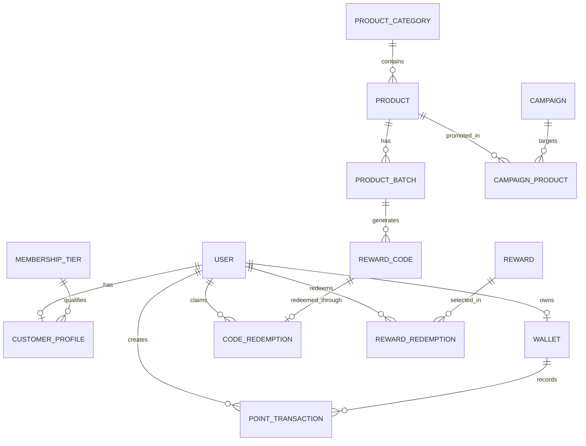

# BIKAJI REWARDS
## Master Project Development Blueprint

**Project Type:** Customer Loyalty & Rewards Management System  
**Proposed Client:** Bikaji Foods International Ltd.  
**Project Name:** Bikaji Rewards  
**Initial Product Category:** Premium Namkeen Products  
**Initial Product Eligibility:** Products with MRP strictly greater than ₹150  
**Backend:** Python, Django, Django REST Framework  
**Frontend:** React  
**Database:** PostgreSQL  
**Architecture:** Modular Monolith with REST API  
**Project Status:** Planning / Development Not Started  
**Document Version:** 1.0

---

# 1. Project Overview

## 1.1 Project Introduction

Bikaji Rewards is a proposed digital customer loyalty platform designed to encourage repeat purchases of eligible Bikaji products.

The system will allow customers to collect loyalty points by scanning unique QR codes placed inside eligible product packages.

Each eligible product package will contain an individual, unique QR code linked to a product, manufacturing batch and predefined reward value.

When a customer scans the QR code:

1. The customer is redirected to the Bikaji Rewards website.
2. New customers register and verify their mobile number through OTP.
3. Existing customers log in through their existing account.
4. The system validates the unique QR token.
5. The backend identifies the associated product and reward value.
6. If the token is valid and unused, the customer receives points.
7. The customer's wallet, transaction history and membership progress are updated.

The platform will also provide an administrative dashboard through which Bikaji administrators can manage products, generate QR codes, configure rewards, monitor customers, manage campaigns and analyse customer engagement.

## 1.2 Primary Business Objectives

The project aims to:

- Increase repeat purchases of eligible Bikaji products.
- Establish a direct digital relationship between Bikaji and its customers.
- Encourage customers to purchase premium products.
- Introduce a points-based loyalty programme.
- Improve customer retention through rewards and membership levels.
- Understand product-level customer engagement.
- Support targeted promotional campaigns.
- Detect suspicious QR redemption activity.
- Provide business analytics to administrators.

## 1.3 Problem Statement

Traditional packaged-product purchases often provide manufacturers with limited direct information about individual customers.

Bikaji Rewards proposes a system that converts eligible physical product purchases into digital customer interactions.

By introducing unique, single-use QR tokens inside selected product packages, the company can provide customers with loyalty points while collecting useful engagement information.

The platform is intended to support customer retention and promotional decision-making. Increased sales will be measured rather than assumed.

---

# 2. Project Scope

## 2.1 Initial Scope

The first version will focus on:

- Premium Bikaji products with MRP greater than ₹150.
- Namkeen product category.
- Individual unique QR codes for eligible packages.
- Customer registration and login.
- One-time mobile OTP verification during initial registration.
- QR-based product claim.
- Product-specific reward points.
- Customer loyalty wallet.
- Points transaction history.
- Reward catalogue.
- Reward redemption.
- Membership levels.
- Administrative dashboard.
- QR batch management.
- Basic fraud detection.
- Business analytics.
- Automated backend testing.

## 2.2 Out of Scope for the Initial Version

The following features will not be mandatory for the first release:

- Retailer POS integration.
- Distributor management.
- Payment gateway integration.
- Automated cashback transfers.
- Warehouse and inventory management.
- Actual factory machinery integration.
- AI-powered customer recommendations.
- Native Android or iOS applications.
- Automated physical reward delivery.
- Production SMS gateway integration if unavailable during the academic prototype.

These features may be introduced in later versions.

## 2.3 Product Eligibility Rules

Initial business rule:

`MRP > ₹150`

Examples:

| Product MRP | Eligible |
|---:|---|
| ₹50 | No |
| ₹100 | No |
| ₹150 | No |
| ₹180 | Yes |
| ₹250 | Yes |
| ₹350 | Yes |
| ₹500 | Yes |

Important:

- Eligibility must be configurable through the admin dashboard.
- MRP must come from the registered product record.
- Customers must never be allowed to submit their own MRP or points value.
- A product may be disabled from the loyalty programme without deleting its historical claims.
- The eligibility rule should be checked when a manufacturing batch is created.

The initial project assumes eligible products can be identified by SKU and that a packaging process can insert a unique QR code inside each package.

---

# 3. User Roles and Permissions

The system will support three primary roles.

## 3.1 Customer

Customers can:

- Register an account.
- Verify their mobile number.
- Log in and log out.
- View their profile.
- Scan or open a product QR claim link.
- Claim eligible product rewards.
- View available points.
- View points transaction history.
- View membership level.
- View available rewards.
- Redeem rewards.
- View redemption history.
- View active promotional campaigns.
- Receive notifications.
- Report a problem with a reward claim.

Customers cannot:

- Generate product QR codes.
- Change product reward values.
- Modify their points balance directly.
- Redeem a QR token belonging to another already-redeemed transaction.
- Access administrative information.

## 3.2 Administrator

Administrators can:

- Manage products and categories.
- Create and manage manufacturing batches.
- Configure product eligibility.
- Generate unique QR tokens.
- Export QR production data.
- Monitor QR token status.
- Manage customers.
- View customer wallets and transactions.
- Configure reward values.
- Manage rewards and redemption rules.
- Create promotional campaigns.
- Monitor suspicious activity.
- Suspend accounts when justified.
- View analytics and reports.
- Review reward disputes.
- Audit administrative actions.

## 3.3 System

Automated system responsibilities include:

- Generating secure random QR tokens.
- Validating token claims.
- Preventing duplicate redemptions.
- Calculating reward points.
- Updating wallet balances.
- Evaluating membership levels.
- Checking reward eligibility.
- Recording audit events.
- Detecting suspicious patterns.
- Expiring campaigns and rewards according to configured rules.

For the MVP, Django Admin can support internal administrative operations while the React application provides the primary customer experience and a dedicated administrative dashboard.

---

# 4. Real-World Business Workflow

## 4.1 Manufacturing and QR Generation

The manufacturing process begins before the customer purchases a product.

1. Administrator logs into the Bikaji Rewards administration portal.
2. Administrator selects an eligible product.
3. Administrator creates or selects a manufacturing batch.
4. System checks that the product is eligible.
5. Administrator specifies the number of packages requiring QR codes.
6. System generates the required number of unique cryptographically random tokens.
7. Each token is associated with:
   - Product ID
   - SKU
   - Manufacturing batch
   - Configured point value
   - Token status
   - Generation timestamp
8. System generates QR artwork and a production export.
9. QR codes are transferred to the authorised packaging workflow.
10. Each QR is printed or inserted inside the corresponding package.
11. Production staff reconcile printed and rejected codes.

The software must support generation of at least 100,000 unique codes per batch-generation job.

The code-generation module must not depend on generating a token manually for every product.

### Manufacturing statuses

- Generated
- Exported
- Printed
- Packed
- Active
- Redeemed
- Revoked

The academic prototype may simulate printing and packing statuses. Actual packaging-line integration is outside the initial scope.

## 4.2 Customer Purchase and Claim Workflow

1. Customer purchases an eligible Bikaji product.
2. Customer opens the package.
3. Customer finds the QR code inside.
4. Customer scans the QR using their phone.
5. Browser opens the Bikaji Rewards claim URL.
6. Website checks the customer's authentication status.

### New customer

1. Customer selects Register.
2. Customer enters mobile number.
3. System sends OTP.
4. Customer verifies OTP.
5. System creates a customer account.
6. System establishes an authenticated session.
7. Customer is redirected to the original pending QR claim.

### Existing customer

1. Customer is already authenticated or selects Login.
2. Customer enters their login credentials.
3. System authenticates the customer.
4. Customer returns to the pending QR claim.
5. No repeated OTP should be required during normal login.

OTP policy:

- OTP is required for initial mobile-number verification.
- A successfully verified mobile number should not require OTP again during ordinary logins.
- OTP can be required again for account recovery, phone-number changes or security-sensitive operations.
- OTP must have an expiry time and one-time verification.
- OTP must never be stored or logged in plaintext.

## 4.3 QR Validation Workflow

When the authenticated customer claims a QR token:

1. Frontend sends the token to the backend.
2. Backend authenticates the customer.
3. Backend hashes the received token and looks up the matching token hash.
4. Backend verifies that the token exists.
5. Backend verifies that the token is active.
6. Backend verifies that the associated product is eligible.
7. Backend verifies that the token has not been redeemed or revoked.
8. Backend retrieves the reward value from trusted database records.
9. Backend calculates any eligible campaign bonus.
10. Backend creates a redemption record.
11. Backend creates a points transaction.
12. Backend updates the customer wallet.
13. Backend updates membership progress.
14. Backend records the claim timestamp.
15. Frontend displays a success message.

All financial-like point accounting operations must happen inside a database transaction.

If any critical operation fails, the entire redemption must roll back.

### Invalid claim scenarios

The system must handle:

- Invalid token.
- Unknown token.
- Previously redeemed token.
- Revoked token.
- Inactive product.
- Ineligible product.
- Expired campaign.
- Suspended customer account.
- Concurrent claim attempts.
- Network interruption.
- Duplicate API requests.

The backend must never award points twice for the same token.

## 4.4 Customer Reward Redemption Workflow

1. Customer opens the rewards catalogue.
2. Customer selects a reward.
3. System checks reward availability.
4. System checks customer points balance.
5. System checks membership or campaign eligibility.
6. Customer confirms redemption.
7. Backend verifies the balance again.
8. Backend creates a redemption record.
9. Backend creates a debit transaction in the points ledger.
10. Backend updates the wallet.
11. System generates a unique reward voucher or redemption reference where applicable.
12. Customer sees the redemption confirmation.

For physical rewards, fulfilment can initially be marked as manually managed by an administrator.

---

# 5. QR Code and Token Design

## 5.1 QR Strategy

Each eligible physical package receives an individual QR code.

The QR code must contain a claim URL with an unpredictable token.

Illustrative URL:

`https://bikajirewards.example/claim/<unique-token>`

The domain above is a placeholder.

The QR token must not directly expose:

- Product ID
- MRP
- Reward points
- Customer ID
- Manufacturing batch details

The backend should determine all product and reward information using its database records.

## 5.2 Token Generation

Use Python's `secrets` module for cryptographically secure random token generation.

Recommended token entropy: 128 bits.

The system should:

- Generate tokens securely.
- Hash tokens before storing them in the primary database.
- Enforce a unique database constraint on token hashes.
- Retry safely if a database uniqueness collision occurs.
- Never use sequential IDs as claim tokens.
- Never use predictable timestamps or product IDs as security tokens.

## 5.3 QR and Manual Code Support

The initial customer method will be QR scanning.

A human-readable fallback code may also be printed beneath or beside the QR.

Both representations must map to the same underlying token.

They must not create two independent redemption records.

The customer should be able to:

- Scan the QR code, or
- Visit the claim page and manually enter the printed code.

The same backend validation process must be used for both methods.

## 5.4 Scale Requirements

The system must support:

| Measurement | Target |
|---|---:|
| QR codes per generation batch | 100,000 |
| Codes per day (illustrative production volume) | 100,000 |
| Codes per month | 3,000,000 |
| Codes per year | 36,500,000 |

The system must use bulk database insertion and avoid unnecessary individual database requests during generation.

QR image generation and production export should be designed as a separate batch-processing operation rather than a customer-facing web request.

For the MVP, generation may run as a management command or background job.

---

# 6. Technology Stack and Architecture

## 6.1 Backend

- Python 3.12 or another supported stable Python release.
- Django.
- Django REST Framework.
- PostgreSQL.
- JWT authentication or secure session-based authentication.
- Pillow and qrcode for QR generation.
- Pytest and pytest-django for testing.

## 6.2 Frontend

- React.
- Vite.
- JavaScript or TypeScript.
- React Router.
- Axios or Fetch API.
- Tailwind CSS or Bootstrap.
- A QR scanning library compatible with mobile browsers.

## 6.3 Infrastructure

Development:

- Local Django server.
- Local React development server.
- Local PostgreSQL instance.
- Environment variables stored in `.env`.

Deployment:

- Backend application hosting.
- Frontend static hosting.
- Managed PostgreSQL.
- HTTPS.
- Production environment variables.
- Database backup.
- Application logging.

The initial architecture will be a modular monolith.

This means one Django backend will contain multiple independent Django apps rather than separate microservices.

This is preferable for the academic project because it reduces deployment complexity while maintaining clear module boundaries.

---

# 7. Backend Django Application Structure

The backend will contain **8 primary Django applications**.

```text
backend/
│
├── config/
│   ├── settings/
│   ├── urls.py
│   ├── asgi.py
│   └── wsgi.py
│
├── apps/
│   ├── accounts/
│   ├── catalog/
│   ├── batches/
│   ├── qr_codes/
│   ├── loyalty/
│   ├── rewards/
│   ├── campaigns/
│   └── analytics/
│
├── common/
│   ├── permissions.py
│   ├── exceptions.py
│   ├── pagination.py
│   ├── validators.py
│   └── utils.py
│
├── tests/
│
├── manage.py
├── requirements.txt
└── .env.example
```

Audit events and administrative activity should initially be implemented through shared audit models and services rather than adding unnecessary complexity to the first release.

## 7.1 App 1: Accounts

Purpose: Manage customer identities, authentication and access control.

Submodules:

- Registration
- Login
- Logout
- Mobile verification
- OTP management
- User profiles
- Role management
- Password recovery
- Account status
- Customer preferences

Main models:

**User**
- id
- mobile_number
- email (optional)
- password
- role
- is_mobile_verified
- is_active
- created_at
- updated_at

**OTPVerification**
- id
- user or registration reference
- mobile_number
- otp_hash
- expires_at
- verified_at
- attempts
- created_at

**CustomerProfile**
- id
- user
- full_name
- city
- date_of_birth (optional)
- marketing_consent
- created_at

Requirements:

- Mobile numbers must be unique.
- OTPs must be one-time and time-limited.
- OTP resend and verification attempts must be rate-limited.
- Existing verified customers must not be forced through OTP on every login.
- Customer data must be protected from other customers.

## 7.2 App 2: Catalog

Purpose: Manage Bikaji product information.

Submodules:

- Product categories
- Product management
- SKU management
- Product eligibility
- MRP configuration
- Reward configuration
- Product activation

Main models:

**ProductCategory**
- id
- name
- description
- is_active

**Product**
- id
- category
- product_name
- sku
- pack_size
- mrp
- is_loyalty_eligible
- default_points
- is_active
- created_at
- updated_at

Requirements:

- SKU must be unique.
- Product MRP must be greater than zero.
- Product eligibility must be configurable.
- Product points must be determined by trusted backend configuration.
- Historical transactions must retain their original awarded point values even if product configuration changes later.

## 7.3 App 3: Batches

Purpose: Manage manufacturing batches.

Submodules:

- Batch creation
- Product association
- Manufacturing information
- QR quantity planning
- Batch status
- Production reconciliation
- Batch reports

Main model:

**ProductBatch**
- id
- product
- batch_number
- manufacturing_date
- expiry_date
- planned_quantity
- generated_quantity
- printed_quantity
- rejected_quantity
- packed_quantity
- status
- created_at

Requirements:

- Each batch belongs to a registered product.
- A batch cannot generate loyalty codes for an ineligible product.
- Batch numbers must be unique according to the chosen business rule.
- Manufacturing quantities must be validated.
- Historical batch records must not be deleted if QR codes have been generated.

## 7.4 App 4: QR Codes

Purpose: Generate, manage and validate unique product QR tokens.

Submodules:

- Secure token generation
- QR image generation
- Token hashing
- Bulk generation
- Batch association
- QR export
- Code activation
- Code revocation
- Token validation
- Redemption status

Main models:

**RewardCode**
- id
- product_batch
- token_hash
- points_value
- status
- generated_at
- activated_at
- redeemed_at
- revoked_at

**CodeRedemption**
- id
- reward_code
- customer
- points_awarded
- redeemed_at
- request_reference

Requirements:

- Token hashes must be unique.
- A token can be redeemed only once.
- Token generation must use cryptographically secure randomness.
- The system must support at least 100,000 tokens per batch job.
- Codes must be linked to their manufacturing batches.
- Revoked codes must never be claimable.
- Redemption must be protected against race conditions.
- Raw tokens must only be exposed through an authorised production export process.
- Raw tokens must never appear in normal application logs.

The token and redemption data should have database-level protections against duplicate redemption, not just frontend checks.

## 7.5 App 5: Loyalty

Purpose: Manage customer points and membership levels.

Submodules:

- Customer wallet
- Points earning
- Points spending
- Points transaction history
- Membership tiers
- Tier progression
- Points adjustment
- Points reversal
- Wallet reconciliation

Main models:

**Wallet**
- id
- customer
- current_balance
- lifetime_earned
- lifetime_redeemed
- updated_at

**PointTransaction**
- id
- wallet
- transaction_type
- points
- reference_type
- reference_id
- description
- created_at

**MembershipTier**
- id
- name
- minimum_points
- maximum_points
- benefits
- is_active

Requirements:

- Points must be stored as integers.
- Every point change must create a ledger transaction.
- Customers must not be able to edit wallet balances.
- Redemptions must never make a wallet balance negative.
- Reversals must create new transactions instead of silently deleting old transactions.
- Membership progress must be calculated from the configured qualification rule.

Initial suggested membership tiers:

| Tier | Lifetime earned points |
|---|---:|
| Bronze | 0–99 |
| Silver | 100–299 |
| Gold | 300+ |

These thresholds are provisional business assumptions.

For the first version, membership is based on lifetime points earned. Later versions may use rolling 12-month activity.

## 7.6 App 6: Rewards

Purpose: Manage redeemable customer rewards.

Submodules:

- Reward catalogue
- Reward configuration
- Reward availability
- Reward eligibility
- Reward redemption
- Voucher generation
- Redemption history
- Fulfilment status

Main models:

**Reward**
- id
- title
- description
- reward_type
- points_required
- stock_quantity (optional)
- valid_from
- valid_until
- is_active

**RewardRedemption**
- id
- customer
- reward
- points_spent
- redemption_reference
- status
- redeemed_at
- fulfilled_at

Initial reward types:

- Free Bikaji products.
- Discount coupons.
- Gift hampers.

Cashback should remain a future enhancement because it requires additional financial and payment integrations.

## 7.7 App 7: Campaigns

Purpose: Manage promotional campaigns.

Submodules:

- Campaign creation
- Campaign scheduling
- Product-specific campaigns
- Bonus points
- Double points
- Customer eligibility
- Campaign limits
- Campaign performance

Main models:

**Campaign**
- id
- name
- description
- start_date
- end_date
- campaign_type
- bonus_points
- multiplier
- maximum_claims
- is_active

**CampaignProduct**
- id
- campaign
- product

Requirements:

- Campaign dates must be validated.
- Campaign rules must be checked on the backend.
- Campaign bonuses must not be calculated using customer-supplied values.
- Campaign stacking must follow a documented rule.
- Every bonus must be recorded in the points ledger.

Initial campaign examples:

- Festival bonus points.
- Premium product promotion.
- Double points campaign.
- Product discovery campaign.

## 7.8 App 8: Analytics

Purpose: Provide administrative insights into the loyalty programme.

Submodules:

- Customer statistics
- QR generation reports
- QR redemption reports
- Product performance
- Batch performance
- Points liability
- Reward redemption statistics
- Campaign performance
- Fraud indicators
- Date-based reporting

Key dashboard metrics:

- Total registered customers.
- Verified customers.
- Total generated QR codes.
- Total redeemed QR codes.
- Unused active QR codes.
- QR redemption rate.
- Total points issued.
- Total points redeemed.
- Outstanding points liability.
- Repeat claiming customers.
- Product-wise claim volume.
- Campaign participation.
- Suspicious redemption attempts.

The dashboard must distinguish between QR claims and actual retail sales. Without retailer/POS data, the platform cannot claim that every redeemed QR represents a verified completed sale.

---

# 8. Frontend React Application Structure

The frontend should contain customer-facing and administrative interfaces.

```text
frontend/
│
├── src/
│   ├── assets/
│   │
│   ├── components/
│   │   ├── common/
│   │   ├── forms/
│   │   ├── navigation/
│   │   ├── cards/
│   │   └── charts/
│   │
│   ├── layouts/
│   │   ├── PublicLayout.jsx
│   │   ├── CustomerLayout.jsx
│   │   └── AdminLayout.jsx
│   │
│   ├── pages/
│   │   ├── public/
│   │   ├── authentication/
│   │   ├── customer/
│   │   └── admin/
│   │
│   ├── features/
│   │   ├── accounts/
│   │   ├── products/
│   │   ├── qr-claims/
│   │   ├── wallet/
│   │   ├── rewards/
│   │   ├── membership/
│   │   ├── campaigns/
│   │   └── analytics/
│   │
│   ├── services/
│   │   ├── api.js
│   │   ├── auth.service.js
│   │   ├── claim.service.js
│   │   └── reward.service.js
│   │
│   ├── hooks/
│   ├── context/
│   ├── routes/
│   ├── utils/
│   ├── App.jsx
│   └── main.jsx
│
├── package.json
└── .env.example
```

## 8.1 Public Pages

- Landing page
- About the rewards programme
- How it works
- Login
- Registration
- Terms and conditions
- Privacy policy
- Contact/support

## 8.2 Authentication Pages

- Registration form
- Mobile OTP verification
- Login form
- Forgot password
- Account recovery

## 8.3 Customer Dashboard

The customer dashboard should show:

- Available points.
- Membership tier.
- Progress to next tier.
- Total claimed products.
- Recent points transactions.
- Available rewards.
- Active campaigns.
- Notifications.

## 8.4 QR Claim Pages

- QR claim landing page.
- Login/register redirect.
- Pending claim continuation.
- Claim validation.
- Successful reward confirmation.
- Invalid or previously claimed code screen.
- Manual code entry.

## 8.5 Rewards Pages

- Rewards catalogue.
- Reward details.
- Redemption confirmation.
- Customer redemption history.

## 8.6 Admin Pages

- Admin overview.
- Product management.
- Batch management.
- QR generation.
- QR export.
- QR status monitoring.
- Customer management.
- Reward configuration.
- Campaign management.
- Redemption management.
- Fraud monitoring.
- Analytics and reports.

---

# 9. Database Relationship Overview

The initial database relationship is:



The exact implementation may use additional foreign keys or explicit transaction reference models where appropriate.

Important database rules:

- Unique customer mobile numbers.
- Unique product SKUs.
- Unique batch identifiers.
- Unique QR token hashes.
- One redemption per QR token.
- One wallet per customer.
- Non-negative wallet balances.
- Valid point transaction types.
- Appropriate foreign-key deletion policies.
- Indexes for token hashes, batch IDs, customer IDs and transaction dates.

Historical financial-like records should be protected from accidental deletion.

---

# 10. API Development Plan

All APIs should be versioned under:

`/api/v1/`

## 10.1 Authentication APIs

| Method | Endpoint | Purpose |
|---|---|---|
| POST | /auth/register/ | Register customer |
| POST | /auth/verify-otp/ | Verify mobile OTP |
| POST | /auth/login/ | Login |
| POST | /auth/logout/ | Logout |
| POST | /auth/refresh/ | Refresh access token if JWT is used |
| POST | /auth/forgot-password/ | Start account recovery |
| GET | /auth/profile/ | Retrieve customer profile |
| PATCH | /auth/profile/ | Update profile |

## 10.2 Product APIs

| Method | Endpoint | Purpose |
|---|---|---|
| GET | /products/ | List eligible products |
| GET | /products/{id}/ | Product details |
| POST | /admin/products/ | Create product |
| PATCH | /admin/products/{id}/ | Update product |
| GET | /admin/categories/ | List categories |

## 10.3 Batch APIs

| Method | Endpoint | Purpose |
|---|---|---|
| POST | /admin/batches/ | Create batch |
| GET | /admin/batches/ | List batches |
| GET | /admin/batches/{id}/ | Batch details |
| POST | /admin/batches/{id}/generate-codes/ | Generate codes |
| GET | /admin/batches/{id}/report/ | Batch report |

## 10.4 QR Claim APIs

| Method | Endpoint | Purpose |
|---|---|---|
| POST | /claims/validate/ | Check QR token |
| POST | /claims/redeem/ | Claim product points |
| POST | /claims/manual/ | Manual code claim |
| GET | /claims/history/ | Customer claim history |
| GET | /claims/{id}/ | Claim details |

The validation endpoint must not expose sensitive token details or allow points to be awarded.

The redemption endpoint is the authoritative operation.

## 10.5 Wallet APIs

| Method | Endpoint | Purpose |
|---|---|---|
| GET | /wallet/ | Current wallet |
| GET | /wallet/transactions/ | Transaction history |
| GET | /wallet/summary/ | Points summary |
| GET | /membership/ | Membership status |

## 10.6 Rewards APIs

| Method | Endpoint | Purpose |
|---|---|---|
| GET | /rewards/ | Available rewards |
| GET | /rewards/{id}/ | Reward details |
| POST | /rewards/{id}/redeem/ | Redeem reward |
| GET | /rewards/redemptions/ | Customer redemption history |

## 10.7 Campaign APIs

| Method | Endpoint | Purpose |
|---|---|---|
| GET | /campaigns/ | Active campaigns |
| GET | /campaigns/{id}/ | Campaign details |
| POST | /admin/campaigns/ | Create campaign |
| PATCH | /admin/campaigns/{id}/ | Update campaign |

## 10.8 Analytics APIs

| Method | Endpoint | Purpose |
|---|---|---|
| GET | /admin/analytics/overview/ | Dashboard metrics |
| GET | /admin/analytics/products/ | Product performance |
| GET | /admin/analytics/qr-codes/ | QR redemption statistics |
| GET | /admin/analytics/customers/ | Customer engagement |
| GET | /admin/analytics/rewards/ | Reward statistics |
| GET | /admin/analytics/campaigns/ | Campaign statistics |

All administrative endpoints must require appropriate permissions.

---

# 11. Security and Fraud Prevention

Security is a critical part of the system.

## 11.1 QR Security

- Use cryptographically secure random tokens.
- Use at least 128 bits of token entropy.
- Store token hashes in the primary database.
- Enforce unique token hashes.
- Never expose raw tokens in ordinary API responses.
- Never log raw claim tokens.
- Use HTTPS.
- Prevent repeated redemption.
- Allow authorised token revocation.
- Record redemption timestamps and customer references.

## 11.2 Authentication Security

- OTPs must expire.
- OTPs must be one-time.
- OTP verification attempts must be limited.
- Login attempts must be rate-limited.
- Passwords must use Django's secure password hashing.
- Use secure authentication transport and storage.
- Restrict access by user role.
- Provide safe account recovery.

## 11.3 Redemption Security

The claim operation must use:

- Database transactions.
- Row locking where appropriate.
- Database-level uniqueness constraints.
- Atomic wallet updates.
- Idempotency handling for repeated API requests.
- Immutable transaction history.

## 11.4 Fraud Monitoring

The system should record:

- Repeated invalid code attempts.
- Excessive claims from one account.
- Suspicious device or IP patterns.
- Unusual redemption frequency.
- Repeated attempts on already redeemed codes.
- Claims from suspended accounts.

Device and IP information should be used proportionately and with appropriate privacy safeguards. Shared networks and devices must not automatically be treated as fraud.

## 11.5 Important Business Limitation

An inside-package QR code proves access to a valid package token, not necessarily a verified retail sale.

Possible risks include:

- Theft of unused codes.
- Photographs of unused codes.
- Codes removed from unsold stock.
- Packaging-line code leakage.

Mitigation:

- Concealed QR placement.
- Secure production exports.
- Batch reconciliation.
- One-time redemption.
- Fraud monitoring.
- Optional future scratch PIN.
- Future retailer/POS integration.

The assignment prototype should document this limitation rather than claim that QR codes completely eliminate purchase fraud.

---

# 12. Points and Rewards Business Rules

## 12.1 Initial Points Configuration

Illustrative point values:

| Product MRP | Example points |
|---|---:|
| ₹180 | 20 |
| ₹250 | 30 |
| ₹350 | 40 |
| ₹500 | 60 |

These are provisional values, not actual Bikaji policies.

Points must be configured by product or campaign and calculated by the backend.

## 12.2 Membership Tiers

| Tier | Lifetime earned points |
|---|---:|
| Bronze | 0–99 |
| Silver | 100–299 |
| Gold | 300+ |

Benefits may include:

- Exclusive offers.
- Bonus points.
- Special product promotions.
- Early access to campaigns.

Tier thresholds and benefits must be configurable.

## 12.3 Reward Types

Initial reward catalogue:

1. Free eligible Bikaji products.
2. Discount coupons.
3. Gift hampers.

Future rewards:

- Cashback.
- Partner vouchers.
- Special festival rewards.

## 12.4 Points Expiry

For the first version, points should not expire automatically unless a clearly documented business rule is configured.

If expiry is introduced later, customers must be notified in advance and expiry must be recorded in the transaction ledger.

## 12.5 Reward Budget

Reward economics must be reviewed before production launch.

Bikaji would need to decide:

- Cost per point.
- Reward redemption ratio.
- Maximum promotional liability.
- Product-level reward budget.
- Campaign budget.
- Reward stock availability.

The academic prototype may use illustrative values.

---

# 13. Development Phases and Assignments

Development must be incremental.

Each phase should have its own implementation, tests and Git commits.

## Phase 0: Project Foundation

Tasks:

- Create public GitHub repository.
- Create project folder structure.
- Create README.md.
- Create ASSUMPTIONS.md.
- Create ARCHITECTURE.md.
- Create AI_LOG.md.
- Create backend project.
- Create frontend project.
- Configure PostgreSQL.
- Configure environment variables.
- Create `.env.example`.
- Configure Git and `.gitignore`.

Deliverables:

- Running Django project.
- Running React project.
- Working database connection.
- Initial documentation.
- Initial Git commits.

Acceptance criteria:

- Both frontend and backend start successfully.
- Django connects to PostgreSQL.
- No secret values are committed.

## Phase 1: Accounts and Authentication

Tasks:

- Implement custom Django user model before initial migrations.
- Implement customer roles.
- Implement customer registration.
- Implement mobile OTP verification.
- Implement login and logout.
- Implement customer profile.
- Implement authentication permissions.
- Implement account recovery.

Testing:

- Successful registration.
- Duplicate mobile number rejection.
- Invalid OTP rejection.
- Expired OTP rejection.
- Reused OTP rejection.
- Existing customer login without repeated OTP.
- Unauthorized access rejection.

Deliverable:

A working authentication system.

## Phase 2: Product Catalog and Manufacturing Batches

Tasks:

- Create product category model.
- Create product model.
- Implement product CRUD.
- Implement MRP eligibility.
- Implement product reward configuration.
- Create manufacturing batch model.
- Implement batch creation and validation.
- Create product and batch administration pages.

Testing:

- Duplicate SKU rejection.
- Invalid MRP rejection.
- Product eligibility validation.
- Invalid batch rejection.
- Ineligible product code-generation rejection.

Deliverable:

A working product and batch management module.

## Phase 3: QR Generation Engine

Tasks:

- Implement secure random token generation.
- Implement token hashing.
- Implement unique database constraints.
- Implement bulk token generation.
- Implement QR image generation.
- Implement QR batch export.
- Implement token status tracking.
- Implement batch generation reports.
- Implement manual code fallback.

Testing:

- Generate 100 sample tokens.
- Verify uniqueness.
- Verify QR content.
- Verify correct product association.
- Verify database constraints.
- Test a 100,000-code batch-generation job.
- Measure generation time and memory usage.

Deliverable:

A working QR generation and batch-management module.

## Phase 4: Customer QR Claim System

Tasks:

- Implement QR claim URLs.
- Implement token validation API.
- Implement authentication redirect preservation.
- Implement QR claim page.
- Implement manual code entry.
- Implement token redemption.
- Implement points calculation.
- Implement transaction-safe redemption.
- Implement claim history.
- Implement success and failure pages.

Testing:

- Valid token claim.
- Invalid token claim.
- Duplicate claim.
- Revoked token claim.
- Unauthenticated claim.
- Existing customer claim.
- New customer registration followed by claim.
- Simultaneous redemption attempts.

Deliverable:

A complete customer product-claim workflow.

## Phase 5: Wallet and Membership System

Tasks:

- Create wallet model.
- Create point transaction ledger.
- Implement point credit.
- Implement point debit.
- Implement point reversal.
- Implement wallet summary.
- Implement transaction history.
- Implement membership tiers.
- Implement tier progression.

Testing:

- Correct points credited.
- No duplicate credit.
- No negative wallet balance.
- Correct membership progression.
- Correct transaction history.
- Failed redemption rollback.

Deliverable:

A working customer loyalty wallet.

## Phase 6: Reward Catalogue and Redemption

Tasks:

- Create reward model.
- Implement reward CRUD.
- Implement reward catalogue.
- Implement reward eligibility.
- Implement reward redemption.
- Implement voucher references.
- Implement fulfilment status.
- Implement customer redemption history.

Testing:

- Insufficient balance rejection.
- Inactive reward rejection.
- Expired reward rejection.
- Duplicate request handling.
- Successful redemption.
- Correct wallet debit.

Deliverable:

Complete earning and redemption functionality.

## Phase 7: Campaign Management

Tasks:

- Create campaign model.
- Implement campaign creation.
- Implement campaign scheduling.
- Implement product-specific campaigns.
- Implement bonus points.
- Implement campaign limits.
- Implement campaign reporting.

Testing:

- Active campaign.
- Inactive campaign.
- Expired campaign.
- Product eligibility.
- Bonus calculation.
- Campaign stacking rules.

Deliverable:

A working promotional campaign system.

## Phase 8: Admin Dashboard and Analytics

Tasks:

- Implement administrative dashboard.
- Implement product management pages.
- Implement batch management pages.
- Implement QR generation interface.
- Implement customer management.
- Implement reward management.
- Implement campaign management.
- Implement QR monitoring.
- Implement fraud monitoring.
- Implement analytics charts.

Testing:

- Role-based page access.
- Accurate dashboard totals.
- Accurate QR redemption statistics.
- Correct product reports.
- Correct campaign reports.

Deliverable:

A working administration interface.

## Phase 9: Integration and Quality Assurance

Tasks:

- Integrate frontend and backend.
- Test all major customer journeys.
- Test all administrative journeys.
- Add loading and error states.
- Improve form validation.
- Improve mobile responsiveness.
- Review permissions.
- Review security.
- Add API documentation.
- Add test coverage.
- Resolve integration bugs.

Deliverable:

A complete tested application.

## Phase 10: Deployment and Submission

Tasks:

- Prepare production environment variables.
- Configure production PostgreSQL.
- Deploy Django backend.
- Deploy React frontend.
- Configure HTTPS.
- Configure allowed hosts and CORS.
- Run production migrations.
- Create initial admin user securely.
- Verify database backup.
- Test live application.
- Update README with deployed URL.
- Finalise documentation.
- Review Git commit history.
- Prepare project demonstration.

Deliverable:

A publicly accessible academic prototype and complete submission repository.

---

# 14. Testing Strategy

Testing is required throughout development, not only at the end.

## 14.1 Unit Testing

Test:

- Token generation.
- Token hashing.
- OTP validation.
- Points calculation.
- Membership qualification.
- Reward eligibility.
- Campaign calculation.

## 14.2 Integration Testing

Test:

- Registration to QR claim.
- Login to QR claim.
- QR claim to wallet update.
- Wallet to reward redemption.
- Campaign bonus to point ledger.
- Admin batch generation to QR export.

## 14.3 Security Testing

Test:

- Duplicate QR redemption.
- Simultaneous claim requests.
- Unauthorized customer access.
- Unauthorized admin access.
- Invalid OTP attempts.
- Token guessing protection.
- Invalid reward requests.
- Negative wallet balance prevention.

## 14.4 Performance Testing

Minimum demonstration targets:

- Generate 100,000 QR tokens in a batch job.
- Measure generation time.
- Measure database insertion time.
- Verify unique token count.
- Measure QR image generation time.
- Test claim API under simulated concurrent load.

Performance targets should be measured on the actual development environment and documented rather than claimed without testing.

---

# 15. Project Documentation Requirements

The GitHub repository must contain:

## README.md

Include:

- Project overview.
- Business problem.
- Features.
- Technology stack.
- Architecture overview.
- Setup instructions.
- Environment configuration.
- Database setup.
- Run instructions.
- Test instructions.
- Demo screenshots.
- Deployment URL when available.

## ASSUMPTIONS.md

Document:

- Why only products above ₹150 are eligible.
- Why namkeen is the initial category.
- Assumed availability of inside-package QR printing.
- Assumed product and manufacturing batch information.
- OTP verification policy.
- Initial points structure.
- Membership rules.
- Reward redemption rules.
- Purchase-verification limitations.
- Customer data collection and consent assumptions.
- Campaign and reward-budget assumptions.

## ARCHITECTURE.md

Include:

- Technology selection.
- Backend architecture.
- Frontend architecture.
- Database relationships.
- QR token design.
- Authentication flow.
- Product claim flow.
- Reward redemption flow.
- Security decisions.
- Deployment architecture.

## AI_LOG.md

Record 5–10 meaningful AI interactions.

Include:

- Original prompt.
- AI response or suggested approach.
- Whether the suggestion was correct.
- How it was verified.
- Mistakes identified.
- Corrections made.

At least two genuine examples of AI being wrong and the developer identifying and fixing the error must be documented.

## TESTING.md

Include:

- Test cases.
- Expected results.
- Actual results.
- Failed test cases.
- Fixes applied.
- Manual test evidence if applicable.

## .env.example

Include placeholder environment variables only.

Never commit passwords, API keys, database credentials or actual OTP provider secrets.

---

# 16. Git and Collaboration Strategy

Development must be incremental.

Suggested branch strategy:

- `main`: stable version.
- `develop`: integration branch.
- `feature/accounts`: authentication.
- `feature/catalog`: product and batch management.
- `feature/qr-engine`: QR generation.
- `feature/claims`: customer claims.
- `feature/loyalty`: wallet and membership.
- `feature/rewards`: reward redemption.
- `feature/campaigns`: campaigns.
- `feature/admin-dashboard`: administrative UI.

Suggested commit messages:

- `chore: initialize project structure`
- `docs: add project assumptions`
- `feat(accounts): implement customer registration`
- `feat(accounts): add mobile OTP verification`
- `feat(catalog): implement product management`
- `feat(qr): add secure token generation`
- `feat(qr): implement bulk QR export`
- `feat(claims): implement QR validation`
- `feat(loyalty): implement points wallet`
- `feat(rewards): implement reward redemption`
- `test(claims): add duplicate redemption tests`
- `fix(loyalty): prevent duplicate points credit`

Do not complete the entire application in one commit.

Every meaningful module should be committed after implementation and testing.

---

# 17. Recommended Developer Assignment Breakdown

If multiple developers or AI agents are involved, divide work by module.

| Developer / Agent | Responsibility |
|---|---|
| Developer 1 | Django foundation, accounts and authentication |
| Developer 2 | Product catalog, manufacturing batches and QR engine |
| Developer 3 | Claims, wallet, points and membership |
| Developer 4 | Rewards and campaign management |
| Developer 5 | React customer interface |
| Developer 6 | React admin dashboard and analytics |
| Integration owner | Database contracts, API integration, security and testing |

If only one developer is working, follow the development phases in sequence.

## Rules for AI Coding Agents

Every coding agent must:

1. Read README.md, ASSUMPTIONS.md and ARCHITECTURE.md before coding.
2. Understand the existing folder structure.
3. Inspect existing models and API contracts before modifying them.
4. Never duplicate an existing model or business rule.
5. Never hardcode reward points or eligibility thresholds in frontend code.
6. Never trust customer-submitted product information.
7. Never directly modify wallet balances without creating ledger entries.
8. Never bypass QR token validation.
9. Never expose raw QR tokens in ordinary API responses or logs.
10. Write tests for new business logic.
11. Follow existing naming conventions.
12. Avoid changing unrelated modules.
13. Explain database migrations and their impact.
14. Update documentation when business rules change.
15. Report completed tasks, modified files and test results.

Before implementing a feature, an agent should explain its planned approach and identify dependencies on other modules.

---

# 18. Important Technical Decisions

The following decisions form the initial project baseline:

| Area | Decision |
|---|---|
| Architecture | Modular monolith |
| Backend | Django + DRF |
| Frontend | React |
| Database | PostgreSQL |
| Backend apps | 8 |
| Authentication | Mobile verification + authenticated customer login |
| OTP | One-time initial mobile verification |
| QR token | 128-bit cryptographically secure random token |
| QR location | Inside eligible packaging |
| Eligibility | MRP strictly greater than ₹150 |
| Initial category | Namkeen |
| Redemption | One successful claim per QR token |
| Token storage | SHA-256 hash |
| Points accounting | Transaction ledger |
| Initial tiers | Bronze, Silver, Gold |
| Rewards | Free products, discount coupons, gift hampers |
| QR generation | Bulk batch generation |
| Daily volume target | 100,000 codes |
| Testing | Automated tests + documented manual testing |
| Deployment | Public web application |

---

# 19. Risks and Limitations

| Risk | Mitigation |
|---|---|
| QR code shared before redemption | Concealed packaging and single-use token |
| Code leakage during manufacturing | Secure export and production reconciliation |
| Duplicate claim attempts | Atomic database transactions and unique constraints |
| OTP abuse | Rate limiting and OTP expiry |
| Incorrect reward calculation | Backend-controlled product configuration |
| Unprofitable reward structure | Reward budget and liability monitoring |
| Packaging integration difficulty | Prototype production export and document assumptions |
| Fake purchase claims | Concealed codes, monitoring and future POS integration |
| Customer data misuse | Data minimisation, consent and access control |
| High QR generation volume | Bulk processing and database indexing |

---

# 20. Definition of Project Completion

The project will be considered complete when the following journey works end to end:

1. An administrator creates an eligible Bikaji product.
2. An administrator creates a manufacturing batch.
3. The system generates unique QR codes for that batch.
4. The QR codes are exported for the simulated packaging process.
5. A new customer scans a QR code.
6. The customer registers and verifies their mobile number.
7. The customer returns to the original claim.
8. The backend validates the QR code.
9. The customer receives the correct product-specific points.
10. The customer sees the updated wallet and membership level.
11. The customer selects and redeems an available reward.
12. The points balance is updated correctly.
13. The administrator can view the product, customer, QR and redemption activity.
14. Duplicate redemption attempts are rejected.
15. Automated tests demonstrate the major security and business rules.
16. The application is deployed and documented.

The final submission must also contain the required project documentation, test evidence and meaningful Git history.

---

# 21. Final Project Direction

Bikaji Rewards should be developed as a secure, scalable and modular customer loyalty platform.

The first development priority is not advanced analytics, AI or gamification.

The first priority is to make the following five operations work correctly:

1. Generate a unique QR code for every eligible product package.
2. Recognise and authenticate customers.
3. Validate and redeem a QR code exactly once.
4. Credit the correct points to the customer's wallet.
5. Allow customers to redeem their points for rewards.

Once these operations are reliable, the remaining features can be added in a structured manner.

**Development principle: Build the complete business workflow first, then improve the experience, analytics and scale.**

This document is the initial master specification. Any future change in scope or business rules must be reflected in the project documentation before implementation.